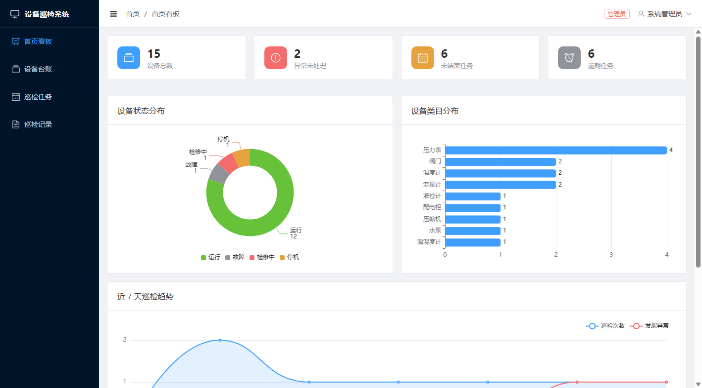
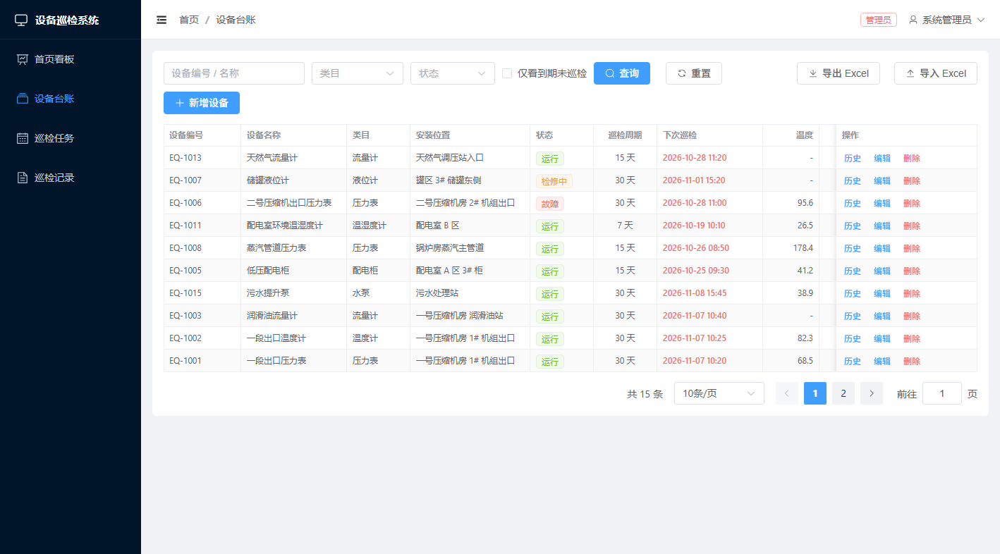
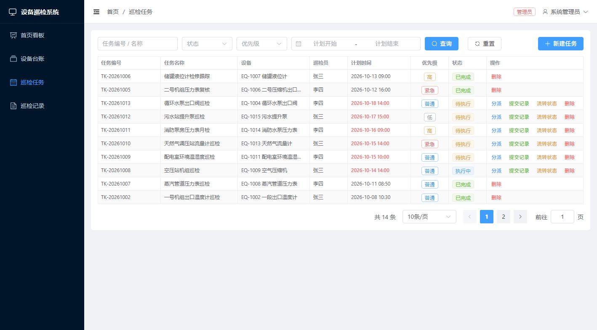
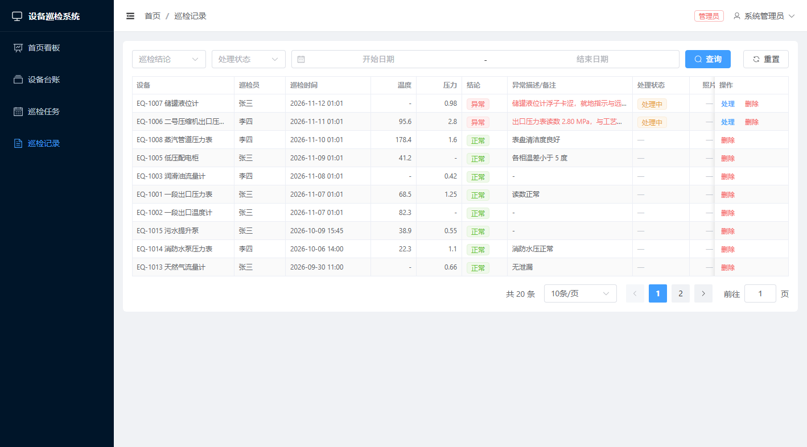

# 工业设备巡检管理系统

[](https://github.com/ffgxfvy/equipment-inspection-system/actions/workflows/ci.yml)
[](#六验证状态)
[](#六验证状态)
[](https://adoptium.net/)

> SpringBoot 3 + MyBatis-Plus + MySQL / H2 + Vue 3 + Element Plus
> 设备台账 · 巡检任务 · 巡检记录 · 异常告警闭环 · ECharts 看板
>
> **零依赖启动**：不需要装 MySQL、Redis，`mvnw spring-boot:run` 直接跑起来（H2 内存库 + 内置种子数据）。

---

## 一、为什么做这个系统

我在本科阶段做过一个**工业仪表维护的机械臂项目**（用 LeRobot + ACT 模仿学习让机械臂擦拭仪表表面）。跑真机的时候我发现，巡检这件事的痛点其实在**流程层面**：

- 设备台账散在 Excel 里，谁改过、什么时候改的说不清；
- 巡检记录靠纸质表格，回到办公室再补录，异常信息滞后好几天；
- 设备该不该巡检、有没有逾期，全靠人记；
- 发现异常之后处理到哪一步了，没有系统跟踪。

**所以我用 SpringBoot + Vue 把这条流程做成了系统。** 因为我在硬件与机器人侧待过（LeRobot 机械臂仪表维护、嵌入式传感器采集），设计数据模型时保留了温度/压力等采集字段，可以直接对接现场仪表或网关上报的数据——这是纯软件背景的开发者容易忽略的地方。

## 系统运行实拍界面

> 以下截图均来自本机实测启动 `dev` profile（H2 内存库）与 Vite 前端的无头浏览器实拍：

<p align="center">
  
  
</p>
<p align="center">
  
  
</p>

## 二、功能

| 模块 | 功能 |
|---|---|
| **登录认证** | JWT 无状态认证，BCrypt 密码哈希，角色区分（管理员 / 巡检员） |
| **设备台账** | 分页 + 多条件查询（编号/名称/类目/状态/位置）、到期未巡检筛选、类目下拉、增删改查（逻辑删除）、巡检历史时间线、**按当前筛选条件导出 Excel**、**从 Excel 导入** |
| **巡检任务** | 创建、编辑、分派巡检员、**状态机流转**（待执行→执行中→已完成/已取消）、逾期高亮、优先级排序 |
| **巡检记录** | 提交记录（含温度/压力/现场照片上传）、异常处理闭环（待处理→处理中→已处理）、按时间范围筛选 |
| **首页看板** | 4 个统计卡片 + 设备状态饼图 + 类目柱状图 + 近 7 天巡检趋势折线 + 待处理异常列表 |

### 三条值得说的业务规则

1. **任务完成后自动回写设备**：状态推进到"已完成"时，把设备的"上次巡检时间"置为完成时间、"下次巡检时间" = 完成时间 + 巡检周期。不需要人工维护这两个字段。
2. **异常联动设备状态**：提交的记录若结论为异常，自动把设备置为"故障"；当该设备所有异常都处理完毕（已处理）后，自动恢复为"运行"。
3. **状态机集中管理**：所有任务状态流转都过 `TaskStatus.canTransfer()`，禁止"已完成 → 待执行"这类非法回退。这条规则有单元测试覆盖。

## 三、技术栈

**后端**

| 技术 | 用途 |
|---|---|
| SpringBoot 3.2.5 | 应用框架 |
| Spring MVC | RESTful 接口 |
| MyBatis-Plus 3.5.6 | ORM、分页插件、逻辑删除、自动填充审计字段 |
| MySQL 8 / H2 | 生产库 / 开发零依赖内存库 |
| Spring Security Crypto | 只用 BCrypt 做密码哈希（不引入整套过滤器链，鉴权走自定义拦截器） |
| JJWT 0.12 | 无状态 token |
| SpringDoc OpenAPI | 自动生成接口文档（Swagger UI） |
| HikariCP | 连接池 |
| Lombok | 减少样板代码 |
| JUnit 5 | 单元测试 |

**前端**

| 技术 | 用途 |
|---|---|
| Vue 3（Composition API） | 框架 |
| Vite 5 | 构建工具 + 开发代理 |
| Element Plus | UI 组件库 |
| Axios | HTTP 封装（统一响应拦截 + 401 处理） |
| Pinia | 状态管理（登录态持久化） |
| Vue Router 4 | 路由 + 登录守卫 |
| ECharts 5 | 看板图表 |

**运维**

| 技术 | 用途 |
|---|---|
| Docker / Docker Compose | 三容器编排（MySQL + 后端 + 前端 nginx） |
| 多阶段构建 | 构建产物与运行环境分离，镜像更小 |
| Nginx | 静态托管 + `/api` 反向代理 + history 路由回落 |

## 四、快速开始

### 方式零：一键启动（最省事）

在项目根目录右键 →「使用 PowerShell 运行」：

| 脚本 | 作用 |
|---|---|
| `start-backend.bat` | 检查 Java → 找可用的 Maven → 启动后端（dev 模式，H2 内存库） |
| `start-frontend.bat` | 检查 Node → 首次自动装依赖 → 启动前端 |

两个脚本会自己找可用的构建工具（优先用工作区内已装好的 Maven，其次用项目自带的 `mvnw`，
最后才找系统 PATH），并在控制台打印访问地址和演示账号。

### 方式一：本地开发（推荐，不需要 Docker）

**前置条件**：JDK 17、Node 18+、IntelliJ IDEA（社区版即可，自带 Maven）

```bash
# 1) 启动后端（默认 dev profile，用 H2 内存库，自动建表 + 灌入演示数据）
cd backend
mvn spring-boot:run
#   后端启动在 http://localhost:8080/api
#   接口文档    http://localhost:8080/api/swagger-ui.html

# 2) 启动前端（新开一个终端）
cd frontend
npm install
npm run dev
#   前端启动在 http://localhost:5173
```

打开 http://localhost:5173 ，用演示账号登录：

| 账号 | 密码 | 角色 | 能做什么 |
|---|---|---|---|
| `admin` | `admin123` | 管理员 | 全部功能，可增删改设备、创建/分派任务 |
| `zhangsan` | `123456` | 巡检员 | 只能查询 + 提交巡检记录 |
| `lisi` | `123456` | 巡检员 | 同上 |

> **没有 Maven？** 用 IDEA 打开 `backend/pom.xml`，等右侧 Maven 面板自动导入依赖后，直接运行 `InspectionApplication`。首次导入需要联网下载依赖（建议在 IDEA 里把 Maven 仓库设成阿里云镜像，见 `docs/development-guide.md`）。

### 方式二：Docker 一键启动（需要 Docker Desktop）

```bash
docker compose -f deploy/docker-compose.yml up -d --build
# 访问 http://localhost  （nginx 80 端口）
```

### 方式三：连真实 MySQL

```bash
# 1) 建库并执行脚本
mysql -uroot -p -e "CREATE DATABASE inspection DEFAULT CHARSET utf8mb4;"
mysql -uroot -p inspection < sql/schema-mysql.sql
mysql -uroot -p inspection < sql/data-mysql.sql

# 2) 用 prod profile 启动，通过环境变量传库配置
cd backend
DB_HOST=localhost DB_USER=root DB_PASSWORD=你的密码 \
  mvn spring-boot:run -Dspring-boot.run.profiles=prod
```

## 五、项目结构

```
equipment-inspection-system/
├── backend/
│   ├── pom.xml
│   ├── Dockerfile
│   └── src/main/java/com/renjie/inspection/
│       ├── InspectionApplication.java     启动类
│       ├── common/                        统一响应、分页、错误码、业务异常、全局异常处理
│       ├── config/                        MyBatis-Plus / Web(跨域+拦截器) / OpenAPI / 字段自动填充
│       ├── security/                      JWT 工具、登录拦截器、角色注解与鉴权、用户上下文
│       ├── entity/                        4 个实体 + 状态常量（含关联展示字段）
│       ├── mapper/                        MyBatis-Plus Mapper
│       ├── service/                       业务逻辑（设备 / 任务 / 记录 / 看板 / 认证 / 文件）
│       ├── controller/                    7 个 REST 控制器
│       └── dto/                           请求体与查询对象（含校验注解）
│   └── src/main/resources/
│       ├── application.yml                公共配置
│       ├── application-dev.yml            H2 内存库（零依赖）
│       ├── application-prod.yml           MySQL
│       ├── schema-h2.sql / data-h2.sql    建表 + 演示数据
│   └── src/test/java/.../
│       ├── ApiResponseTest.java / EquipmentExcelServiceTest.java
│       ├── EquipmentImportParseTest.java / TaskStatusTest.java
│       └── RecordPageTest.java            状态机、Excel 与查询回归单元测试（46 用例）
├── frontend/
│   ├── package.json / vite.config.js / index.html
│   ├── Dockerfile / nginx.conf
│   └── src/
│       ├── main.js / App.vue
│       ├── router/index.js                路由 + 登录守卫
│       ├── store/user.js                  登录态（Pinia）
│       ├── utils/request.js               Axios 封装（拦截器）
│       ├── api/                           按模块拆分的接口定义
│       ├── layout/index.vue               侧边栏 + 顶栏布局
│       ├── components/RecordFormDialog.vue 提交巡检记录弹窗
│       └── views/                         Login / Dashboard / Equipment / Task / Record
├── sql/
│   ├── schema-mysql.sql                   建表脚本（MySQL 版）
│   └── data-mysql.sql                     演示数据
├── start-backend.bat                           一键启动后端（自动找 Maven）
├── start-frontend.bat                           一键启动前端（自动装依赖）
├── .github/workflows/ci.yml               CI：后端测试 + 接口冒烟 + 前端构建
├── deploy/docker-compose.yml              三容器编排
└── docs/
    ├── development-guide.md               从零到跑通的完整指南（含 IDEA 配置、常见报错）
    ├── api.md                             接口清单与说明
    └── design-notes.md                    设计取舍记录（面试可讲）
```

## 六、验证状态

这个项目的**每一层都实际跑过**，不是只写了代码：

| 验证项 | 结果 | 怎么验证的 |
|---|---|---|
| 后端编译 | ✅ 55 个 Java 主源码文件 + 5 个测试文件全部编译通过 | `mvn -o test package` |
| 单元测试 | ✅ **46 个用例通过**（状态机 / Excel 读写 / 统一响应 / 日期查询边界） | `mvn -o test`（`RecordPageTest` 防止 MyBatis-Plus 条件下急切求值 NPE/400） |
| 接口冒烟测试 | ✅ **本地 19 项核心链路全通 + GitHub Actions CI 7 项端点断言** | 起服务后用 Python / curl 逐个调接口 |
| 前端界面实测 | ✅ 4 大核心页面实机截图验证无控制台/弹窗报错 | Chrome Headless + Vite 联调截图至 `assets/ui-*.png` |
| Excel 读写校验 | ✅ `EquipmentExcelServiceTest` (10 例) + `EquipmentImportParseTest` (12 例) + 线上 `/equipments/export` 二进制 PK 头实测 | `mvn -o test` + 线上下载校验 (`5941 B`) |
| 前端构建 | ✅ 2240 个模块打包通过（含代码分包与 Element Plus/ECharts） | `npm run build` |
| 启动方式 | ✅ `mvn spring-boot:run` 与 `java -jar --spring.profiles.active=dev` | 本机独立启动验证通过 |

### 实测与 CI 覆盖矩阵

不只是"接口能通"，重点验证**业务规则、鉴权与边界防御**（本地起服务后实测 19 项接口全绿，GitHub Actions CI 每次推送执行 46 项单测 + 7 项接口冒烟 + 前端生产构建）：

| 分组 | 实测项 | 关键用例 |
|---|---|---|
| 认证与 RBAC | 5 | 管理员/巡检员登录、错误密码拒登、无 Token → `401`、巡检员越权建设备 → `403` |
| 设备台账与导出 | 4 | 分页总数 (`15`)、类目去重、`overdueOnly` 到期筛选、`/equipments/export` 有效 `.xlsx` 二进制流 |
| 看板与巡检记录 | 2 | `/dashboard` 5 组统计块完整返回、`/records` 无日期范围全量分页 (`20` 条) |
| 任务与状态机 | 2 | `/tasks` 分页关联回填、`DONE → PENDING` 非法流转被拒 (`409`) |
| 校验与边界兜底 | 6 | 编号重复 (`409`)、异常结论缺描述 (`400`)、畸形 JSON (`400`)、不存在 ID/路径 (`404`)、错误 HTTP 方法 (`405`) |

### 联调中实际发现并修掉的 3 个真实问题

这三个问题都是**只看代码或只写 Mock 单元测试发现不了的**，必须跑起来或全栈联调才暴露：

**1. 巡检记录首页空日期触发 MyBatis-Plus 急切求值报错（UI 联调发现）**
在 `InspectionRecordService.page()` 里曾写 `.ge(hasText(startDate), InspectTime, parseStart(startDate))`。Java 方法调用前会**先求值全部实参**——即使 `hasText(null)` 返回 `false`，`parseStart(null)` 仍被执行，导致前端进入 `/record` 页面立刻弹窗「开始日期格式应为 yyyy-MM-dd：null」。改成先三元运算求值 `start`/`end` 为 `null` 后再传入 `wrapper`，并在 `RecordPageTest` 与 CI 中补齐回归用例。

**2. 异常结论缺描述时返回 500 而不是 400**
一开始只写了业务异常处理器，参数校验失败、JSON 格式错误这些框架级异常全部落到 `Exception` 兜底里返回 500。补了 6 个针对性的处理器（`HttpMessageNotReadableException`、`MissingServletRequestParameterException`、`MethodArgumentTypeMismatchException`、`HttpRequestMethodNotSupportedException`、`MaxUploadSizeExceededException`、`NoResourceFoundException`）。

**3. HTTP 状态码与前端拦截器冲突，导致用户看不到校验提示**
一开始给错误处理器加了 `@ResponseStatus(BAD_REQUEST)`，让 HTTP 也返回 400——看起来更符合 REST 规范。但前端 axios 拦截器对 HTTP 4xx 会走 error 分支，那里只能拿到状态码，于是界面只显示"请求失败（400）"，服务端写的"结论为异常时，必须填写异常描述"这类提示就被丢掉了。改成 HTTP 恒为 200、业务码放响应体后，前端就能准确展示错误原因（见 `GlobalExceptionHandler` 类注释中的设计取舍说明）。

## 七、数据库设计

四张表，全部带 `deleted`（逻辑删除）与 `create_time` / `update_time` 审计字段。

| 表 | 说明 | 关键字段 |
|---|---|---|
| `sys_user` | 用户 | `username` 唯一、`password`（BCrypt）、`role` |
| `equipment` | 设备台账 | `code` 唯一、`status`、`inspect_cycle_days`、`last_inspect_time` / `next_inspect_time`、`last_temperature` / `last_pressure` |
| `inspection_task` | 巡检任务 | `task_no` 唯一、`equipment_id`、`inspector_id`、`status`、`priority`、`plan_time` / `finish_time` |
| `inspection_record` | 巡检记录 | `task_id`、`equipment_id`、`result`、`abnormal_desc`、`handle_status`、`photo_url` |

**索引设计**：给高频筛选项建了索引——`equipment.status`、`equipment.next_inspect_time`（到期未巡检查询）、`inspection_task.status`、`inspection_record.inspect_time`。这里没有做过度设计，索引数量控制在能覆盖查询条件的范围。

## 八、接口文档

启动后访问 **http://localhost:8080/api/swagger-ui.html**，可以看到全部接口并直接调试。

| 分组 | 主要接口 |
|---|---|
| 认证 | `POST /auth/login` |
| 设备 | `GET/POST /equipments`、`GET/PUT/DELETE /equipments/{id}`、`GET /equipments/categories`、`GET /equipments/{id}/records`、**`GET /equipments/export`（导出）**、**`POST /equipments/import`（导入）** |
| 任务 | `GET/POST /tasks`、`GET/PUT/DELETE /tasks/{id}`、`PUT /tasks/{id}/assign`、`PUT /tasks/{id}/status` |
| 记录 | `GET/POST /records`、`GET /records/{id}`、`PUT /records/{id}/handle`、`DELETE /records/{id}` |
| 看板 | `GET /dashboard` |
| 文件 | `POST /files/upload` |
| 用户 | `GET /users/inspectors` |

详细说明见 [`docs/api.md`](docs/api.md)。

## 九、已知局限与后续优化

诚实列出这个项目"还没做"的部分：

| 局限 | 说明 | 改进方向 |
|---|---|---|
| **dev 模式重启后数据重置** | dev 用 H2 **内存**库，服务一重启就回到 15 台种子设备。导入/新增的数据只在本次运行期间存在。这是刻意的：每次演示都是干净状态 | 要验证数据持久化，切 `prod` profile 连 MySQL；或把 `application-dev.yml` 的 url 改成 `jdbc:h2:file:./data/inspection` |
| 导入不支持覆盖 | 编号已存在的行会报错，不会更新原记录 | 如需覆盖，加一个"按编号 upsert"的开关，但要先确认业务是否允许 |
| 导入仅支持 .xlsx | `.xls` 是另一种二进制格式，需要 HSSFWorkbook | 让用户先另存为 .xlsx，或补 HSSF 支持 |
| 无自助注册 | 用户由种子数据预置 | 加注册接口 + 管理员审批 |
| 权限粒度较粗 | 只有 ADMIN / INSPECTOR 两种角色 | 接入 RBAC（角色-菜单-按钮三级） |
| token 无法主动失效 | JWT 无状态，改密码后旧 token 仍有效 | 引入 Redis 黑名单或改用短期 token + 刷新 token |
| 看板统计在内存里算 | 千级数据没问题，百万级会慢 | 改成按天预聚合的统计表 + 定时任务 |
| 无审计日志 | 谁改了什么查不到 | 加操作日志表 + AOP 切面统一记录 |
| 无接口限流 | 可被高频调用 | 加 Bucket4j 或网关层限流 |
| 缺集成测试 | 只有状态机的单元测试 | 用 MockMvc + Testcontainers 补接口级测试 |

## 十、我负责的部分

单人项目。从需求梳理、数据建模、接口设计、后端实现、前端实现到 Docker 编排与文档，全部独立完成。

技术难点主要在**业务规则的一致性**上：任务的完成、记录的提交、设备状态的变更三者是联动的，任何一步失败都会造成数据不一致，因此统一用 `@Transactional` 包住并做了回滚验证。

---

## 附：演示账号与数据说明

种子数据包含 15 台设备、14 条巡检任务、20 条巡检记录（含 4 条异常记录，覆盖"待处理/处理中/已处理"三种状态），用于演示看板图表与异常闭环流程。数据为演示构造，设备名称为通用示例。
